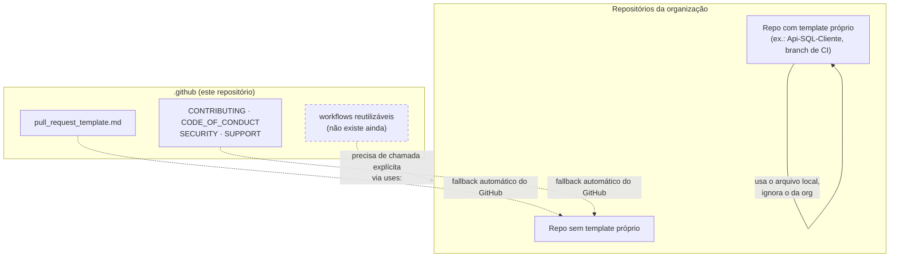

<div align="center">

# .github — Mottainai-One

**Repositório reservado da organização Mottainai-One para configuração compartilhada do GitHub**

*Ponto central previsto para arquivos de saúde da comunidade, templates de issue e pull request e padrões de contribuição do ecossistema Mottainai.*

<br/>

[](https://github.com/Mottainai-One/.github)
[](LICENSE)
[](https://github.com/Mottainai-One/.github/tree/main)

<br/>

[Visão geral](#visão-geral) •
[Arquitetura](#arquitetura) •
[Conteúdo](#estrutura-do-repositório) •
[Como contribuir](#configuração-e-uso) •
[Segurança](#segurança-e-operação) •
[Referências](#referências)

</div>

---

## Visão geral

| | |
|---|---|
| **Problema** | Cada repositório do Mottainai (APIs, frontend, mobiles, POS, BI, RPA, IA) precisaria repetir os mesmos templates e políticas de contribuição. |
| **Responsabilidade** | Guardar arquivos que o GitHub aplica como **padrão da organização** para repositórios que não têm versão própria. |
| **Consumidores** | Todos os repositórios públicos da org `Mottainai-One` e quem abre issues e PRs neles. |
| **Escopo** | Templates de PR/issue, `CONTRIBUTING`, `CODE_OF_CONDUCT`, `SECURITY`, `SUPPORT` e, futuramente, workflows reutilizáveis. |
| **Fora de escopo** | Código de aplicação, CI de projetos específicos e qualquer segredo da organização. |

> [!IMPORTANT]
> Na branch padrão `main`, **só existem `README.md` e `LICENSE`**. Nenhum template ou arquivo de comunidade está ativo hoje como padrão da organização. Os arquivos citados abaixo estão em outras branches e **não** foram mesclados na `main`.

---

## Arquitetura

O repositório não executa código. Ele funciona por convenção do GitHub: arquivos de saúde da comunidade colocados aqui passam a valer para os repositórios da org que **não** tenham o próprio arquivo equivalente.



| Tipo de arquivo | Comportamento esperado no GitHub  |
|---|--- |
| Arquivos de saúde da comunidade | Herdados por repos sem versão própria  |
| Template de pull request | Herdado por repos sem template próprio  |
| Workflows reutilizáveis | Não são herdados; o repo consumidor precisa chamá-los  |

<sub>O comportamento de herança é o documentado pelo GitHub para repositórios `.github` de organização. Ele não foi testado na prática nesta análise.</sub>

---

## Tecnologias

<table>
<tr>
<td align="center" width="140"><br/><b>GitHub</b><br/><sub>Community health files</sub></td>
<td align="center" width="140"><br/><b>Markdown</b><br/><sub>Templates e docs</sub></td>
<td align="center" width="140"><br/><b>PowerShell</b><br/><sub><code>push.ps1</code><br/>(só na branch develop)</sub></td>
<td align="center" width="140"><br/><b>GitHub CLI</b><br/><sub>Usado pelo <code>push.ps1</code></sub></td>
</tr>
</table>

---

## Estrutura do repositório

### Branch `main` (padrão)

```text
.github/
├── LICENSE        # MIT, Copyright (c) 2026 Mottainai-One
└── README.md      # Descrição de uma linha, em inglês
```

### Branch `develop` (não mesclada na `main`)

```text
.github/
├── CODE_OF_CONDUCT.md        # vazio (0 bytes)
├── CONTRIBUTING.md           # vazio (0 bytes)
├── SECURITY.md               # vazio (0 bytes)
├── SUPPORT.md                # vazio (0 bytes)
├── pull_request_template.md  # template de PR em inglês
├── push.ps1                  # git push + espera a PR aparecer via gh
├── render-test.txt           # arquivo de teste
├── LICENSE
└── README.md
```

---

## Configuração e uso

Não há build, dependência nem execução local. Para contribuir:

1. Clone o repositório:
   ```bash
   git clone https://github.com/Mottainai-One/.github.git
   ```
2. Adicione apenas arquivos que façam sentido para **vários** repositórios da organização.
3. Antes de contar com um arquivo como padrão, confira na [documentação do GitHub](https://docs.github.com/en/communities/setting-up-your-project-for-healthy-contributions/creating-a-default-community-health-file) se o tipo de arquivo é herdado e se o repositório alvo não tem uma versão própria.

> [!NOTE]
> Para que os padrões tenham efeito, os arquivos precisam estar na **branch padrão** (`main`). Hoje eles estão só em `develop`.

---

## Testes e integração contínua

Não há workflows, testes ou gates neste repositório, em nenhuma das branches analisadas.

---

## Segurança e operação

| Tema | Situação observada |
|---|---|
| Segredos | Nenhum segredo encontrado nos arquivos da `main` e da `develop`. O template de PR pede que ninguém envie `.env`, tokens ou senhas. |
| `SECURITY.md` | Existe só na `develop`, e **vazio**. A org não tem canal documentado para reportar vulnerabilidades. |
| Histórico | O commit `dde8f1e` na `develop` tem a mensagem *"test PR creation after secret fix"*. Isso sugere um ajuste de segredo na automação de PRs. O conteúdo da correção não está neste repositório. |
| `push.ps1` | Depende do `gh` autenticado na máquina de quem roda. Não manipula credenciais diretamente. |

---

## Referências

- Repositório: <https://github.com/Mottainai-One/.github>
- PR #7 (README em português): <https://github.com/Mottainai-One/.github/pull/7>
- GitHub Docs: [Creating a default community health file](https://docs.github.com/en/communities/setting-up-your-project-for-healthy-contributions/creating-a-default-community-health-file)
- GitHub Docs: [Reusing workflows](https://docs.github.com/en/actions/using-workflows/reusing-workflows)

---

<div align="center">

**Mottainai** · *menos desperdício, mais inteligência no estoque*

<sub>Parte do ecossistema <a href="https://github.com/Mottainai-One">Mottainai-One</a></sub>

</div>

---

<sub>**Rastreabilidade.** Análise em 2026-10-27, na `main` @ `33bda0e`. Arquivos consultados: `README.md` e `LICENSE` (`main`), `pull_request_template.md` e `push.ps1` (`develop` @ `dde8f1e`), `README.md` (`docs/readme-standardization` @ `7329418`), listagem de arquivos de todas as branches e lista de PRs pela API pública do GitHub.</sub>
